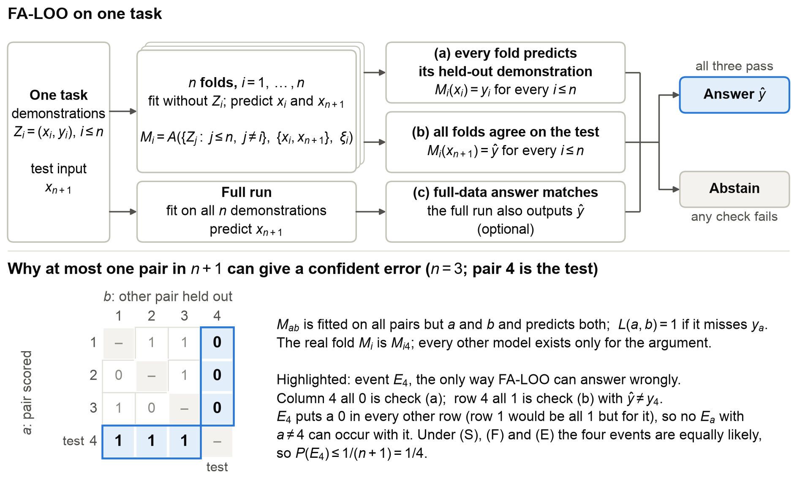
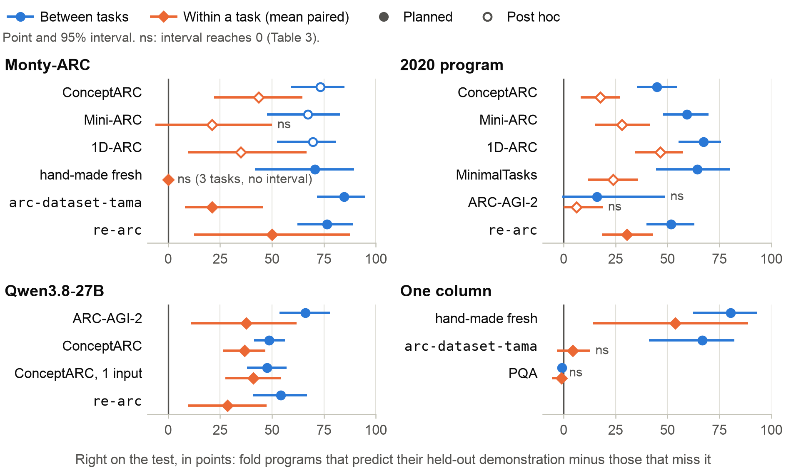
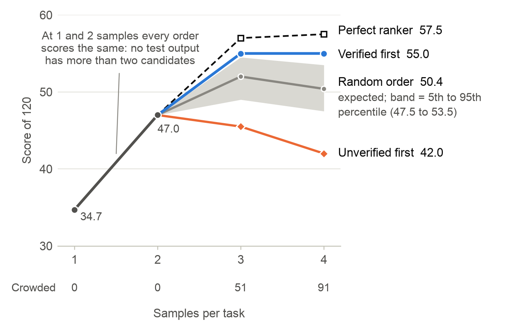
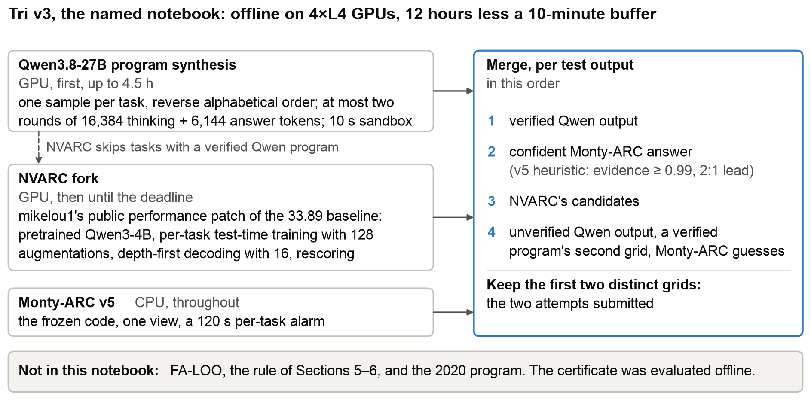

# Verified Is Not Generalised: Held-Out Re-Induction, a Distribution-Free Bound, and Where ARC Solvers Fail

*Subtitle:* Re-running a solver with each demonstration held out separates generalising programs from proxies, gives a bound when folds agree, and tests that bound's premise with the same runs.

**Abdur Rahim**

Track: ARC-AGI-2. This document: https://github.com/ARahim3/arc-monty/blob/main/paper/paper.pdf. Code: https://github.com/ARahim3/arc-monty. Notebook of the named submission (version 3): https://www.kaggle.com/code/rahim3/monty-arc-qwen-nvarc?scriptVersionId=362731624.

## Abstract

A program that fits every demonstration can still be a proxy: about a quarter of an LLM's verified ARC-AGI-2 programs fail the test. Prompted by the Thousand Brains Theory's "predict what you have not observed", we re-run the whole solver with each demonstration held out, as CORA does, and answer only if every fold predicts its held-out demonstration and all folds agree on the test (FA-LOO). If demonstrations and test are exchangeable, the chance of answering wrongly is at most 1/(n+1) for any symmetric learner fixed in advance. On four learners, Monty-ARC among them, fold programs that predict their held-out demonstration beat those that miss it; within a task, by 18–47 points for an LLM and a program frozen in 2020. On fresh generated tasks, where the premises hold by construction, the LLM's rule answers 53.5% of tasks, all right: a case where the bound bites. On human-designed sets the same runs reject the premises for the LLM: there the rule is evidence, not a guarantee. On ARC-AGI-2, retrying failed folds gives 16 of 16 at 13.3% coverage (planned replication, seen split). The rule raises no score: at four samples, verification scores 55.0 of 120 and a perfect ranker 57.5, so proposal, not selection, is the bottleneck. The named submission scores 32.64, inside the band reported for unmodified NVARC forks [10]; Monty-ARC alone scores 0.00.

**Table 1. Leaderboard (ARC-AGI-2, public score). Every leaderboard number for this competition is here.**

| Submission | Ref | Public LB | Role here |
|---|---|---|---|
| Tri v3: Qwen3.8-27B, NVARC fork, Monty-ARC v5 | 57726521 | 32.64 | **Named submission** |
| Tri v3, second run, same notebook | 57851152 | 29.72 | Spread 2.92 |
| Tri v4-A: scheduling changed | 57785855 | 27.36 | Variant |
| Hybrid v3: NVARC fork, Monty-ARC with 7 modules | 57689321 | 28.47 | Public notebook |
| Monty-ARC v5 alone: 8 modules, CPU | 57762908 | 0.00 | Learner under test |
| Monty-ARC v5 alone, re-run, same kernel | 57894567 | 0.00 | Checks the 0.00 |
| Monty-ARC v0: 2 modules | 57661715 | 0.00 | Early version |

*Final field, read 2026-11-07: 3,544 teams, top 88.06, median 29.31; the named submission ranks 220 (59 teams tied at 32.64, listed 220–278); 1,997 teams score 28–34.*

## 1. Question and rule

A program that reproduces every demonstration can still be a proxy, fitting the examples without the rule: at ARC-AGI-2's budget about a quarter of an LLM's verified programs fail on the test. Verified is not generalised. So which verified programs generalise? We give a held-out test that separates them from proxies within a task, a bound on its errors under stated premises, and what its failures say about where ARC solvers fail.

ARC-AGI [1, 2] is a good place to ask. A task shows a few demonstrations, typically two to five input-output grid pairs, and one or more test inputs. The solver must reproduce each test output exactly, with two attempts and no penalty for a wrong one. The 2026 Kaggle competition scores the harder ARC-AGI-2 on 240 hidden tasks in a 12-hour offline run.

The question came from building a solver on the Thousand Brains Theory (TBT) [3–6], a theory of the neocortex in which a model is tested by what it predicts about observations not yet made. For ARC that gives a reusable rule:

> **Re-run the whole solver with each demonstration held out, and answer only if every fold predicts its held-out demonstration and all folds agree on the test.**

We call this fold-agreement leave-one-out (FA-LOO). Leave-one-out is old cross-validation: the theory supplied the question, not the mechanism. Re-induction with each demonstration held out is earlier work (CORA [11]); agreement is what makes a proof possible for any re-runnable learner.

We add the proof (Section 5); tests on four very different learners (6.1, 6.2); a case where the bound bites with its premises true (6.3); a cheap improvement, replicated (6.4); a test of exchangeability from the same runs (6.5); what the rule buys (7); the named submission (8); and what the failures say about where ARC solvers fail (9).

**The theory.** Appendix D reports what ARC can and cannot test about TBT: on exact, fully visible grids, movement and voting change the number of steps, not the answer; Monty-ARC's object frames add solves, not trust; and in a one-column system built to the theory, frames, behaviour in its own frame, the count sensor and memory added nothing we could separate.

## 2. Related work

**ARC solvers.** The 2020 Kaggle winner [21] is a hand-written search over a domain-specific language. NVARC [8], the 2025 winner, fine-tunes Qwen3-4B on synthetic ARC-like data and trains further on each task at test time, as in Akyürek et al. [18]; forum reports put its public forks at about 28–34 [10]. Verifying programs first, with another solver as fallback, is from Li et al. [17]. Franzen et al. [9] vote over task augmentations for ranking, not calibration.

**Hold-out certificates.** CORA [11] came first: July 2026 runs, code public by 2026-10-07 at the latest. We read it before building the system-level wrapper tested here; Monty-ARC's per-module evidence dates from 2026-10-26. CORA accepts a program only if the whole induction, re-run with each demonstration hidden, still predicts the hidden one, and it reports a held-out split like Section 6.1's: certified programs right 40 of 42 times on ARC-AGI-2 training tasks against 37 of 201 for the same search's uncertified train-perfect programs, and "0 of 11 on an evaluation development split". We extend it to four unrelated learners, with within-task controls, and add agreement (b) and its bound.

**Guarantees and abstention.** The proof adapts the leave-two-out tournament of the jackknife+ [12]. With 0–1 scores, (a)+(b) makes the CV+ (jackknife+) classification set [28] at $\alpha=1/(n+1)$ the singleton $\{\hat y\}$, so a confident error is a miscoverage, which the jackknife+ bounds by $2\alpha$; at this $\alpha$ it is a tournament event only one pair can win, hence $1/(n+1)$. Selective classification [22] and KWIK learning [23] also answer only where surviving hypotheses agree, but over a hypothesis class fixed in advance, on noise-free data; here the learner is a black box that is re-run. Conformal abstention [24] sets its threshold with conformal prediction over labelled examples; here a task's own pairs do that work. Testing exchangeability has its own literature [25]. SynGuar [19] guarantees generalisation for programming by example, with far more examples than ARC gives; Zhou et al. [20] calibrate abstention for LLM code generation.

## 3. The learners

**Monty-ARC** is hand-written: eight numpy learning modules (Appendix A), no training data, no memory across tasks. The name records an inspiration; no Monty code runs in it. Each module enumerates hypotheses, keeps those that reproduce every demonstration, scores them by held-out prediction and predicts the test. All tests use v5, frozen and byte-identical to its published notebook.

**Qwen3.8-27B** [16] is an LLM that writes programs: sampling at temperature 1.0, 32k thinking tokens per round, at most two rounds, canonical order, every fold from scratch. A program is *verified* if it reproduces every demonstration it was shown. It ran on the 120 ARC-AGI-2 public evaluation tasks, on which the harness was built; 160 ConceptARC tasks; and 200 `re-arc` tasks.

**The 2020 first-place program** [21] is a hand-written search frozen before ConceptARC, Mini-ARC and 1D-ARC existed, so premise (F) below holds by construction there; its author saw ARC-AGI-1, so concept overlap is not ruled out. We ran its published recipe with per-process limits and canonical order, and it reproduces: pass@3 on ConceptARC is 251 against those authors' 249. It abstains on the 286 of 901 1D-ARC tasks too wide for it, and ran on the 113 ARC-AGI-2 evaluation tasks not shared with ARC-AGI-1.

**The one-column system** is a new program, not Monty: one `Column` class and one matching rule, in 42 copies that differ only in sensor and reach, built to the theory's functional description and frozen with a hash before any test data.

## 4. How it was tested

**Table 2. Data. Pairs shared with Monty-ARC's development tasks, by exact pair; concept overlap is not ruled out.**

| Set | Items | Clusters | Pairs shared |
|---|---|---|---|
| ARC-AGI-2 public evaluation (seen) | 167 pairs | 120 tasks | all |
| ConceptARC [13]: human-designed | 480 pairs | 160 tasks | 0 of 905 |
| Mini-ARC [14]: 5×5 grids | 149 pairs | 149 tasks | 0 of 671 |
| 1D-ARC [15]: generated, one row | 901 pairs | 18 types | 0 of 3,545 |
| ConceptARC MinimalTasks | 48 pairs | 16 tasks | 0 of 93 |
| `re-arc` [26]: fresh draws | 200 pairs | 200 tasks | 0 of 800 |
| Hand-made fresh [27]: four small sets | 80 pairs | 77 tasks | 0, one task excluded |
| `arc-dataset-tama` [27]: generated | 1,567 pairs | 50 types | 0 of 4,624 |
| PQA [27]: generated, secondary | 210 pairs | 7 types | 0 of 700 |
| ARC-AGI-3: 13 held-out games, recorded | 3,120 steps | 13 games | |

**Plans.** Every test had a written plan before its runs on these sets. Monty-ARC's preceded any per-module, per-frame or per-group number on unseen data; overall rule counts on ConceptARC were already known, and it says so. Its seven primary comparisons are all reported (T2c in 6.5, the rest in Appendix C). The 2020 program's was fixed before any output on these sets. Qwen's too, but the held-out split, the discordant test and the same-token comparison were added 55 minutes into the run, with no accuracy computed. Per-request seeds cannot reach this server, so noise comes from a server-wide stream; logits depend slightly on batch composition; 35 of 479 jobs were resumed after preemption. The one-input run (Qwen on ConceptARC, one test input per prompt) was planned on 2026-11-02, after our other results were known; no setting, the retry rule included, was chosen on ConceptARC. The generator control's plan and the one-column system's plan and code were hashed first (our own record). Other analyses are marked post hoc. Nothing is corrected for multiplicity, so an interval just excluding 0 is weak evidence.

**Rules.** *Fit, the usual test:* the learner's top answer only if it reproduces all demonstrations (for Qwen, verified). *FA-LOO:* conditions (a), (b), (c) of Section 5, around the whole system; for Qwen, (c) also requires the full run to verify, which matters only on `re-arc` (108/108 at 54.0% without it).

**Statistics.** Intervals are percentile cluster bootstraps, 10,000 resamples; a difference *separates* if its interval excludes 0, and is `ns` if not. Sets count test pairs, unless marked tasks.

**Roles.** In the *real role* the task's own test pair is the query; in *demo roles* each demonstration in turn plays test; *rotating* runs every role.

## 5. The certificate

### 5.1 Rule and theorem

Let $Z_i=(x_i,y_i)$, $i\le n$, be the demonstrations and $Z_{n+1}=(x_{n+1},y_{n+1})$ the test pair. A learner $A(S,Q,\xi)$ takes labelled pairs $S$, unlabelled queries $Q$ and a seed $\xi$, and returns one prediction per query. Abstaining counts as mispredicting. Three premises:

- **(S) Symmetric.** $A$ depends on $S$ and $Q$ only as unordered collections; a canonical order computed from content achieves this for an LLM.
- **(F) Fixed in advance.** $A$, including code, prompts and weights, is chosen without looking at these pairs. Seeds are i.i.d. and independent of the pairs.
- **(E) Exchangeable.** The joint law of $(Z_1,\dots,Z_{n+1})$ is unchanged when the indices are permuted, conditionally on any other test inputs shown to the learner.

A fold $M_i=A(\{Z_j: j\le n,\ j\ne i\},\ \{x_i,x_{n+1}\},\ \xi_i)$ predicts both of its queries. FA-LOO answers $\hat y$ only if (a) $M_i(x_i)=y_i$ for every $i\le n$; (b) $M_i(x_{n+1})=\hat y$ for every $i\le n$; and, optionally, (c) the model fitted on all $n$ demonstrations also outputs $\hat y$ (Figure 1).

**Theorem.** Under (S), (F) and (E), $P(\text{answer and } \hat y\ne y_{n+1})\le 1/(n+1)$. The same holds conditionally on the unordered multiset $\{Z_1,\dots,Z_{n+1}\}$, and after any further filter such as (c). The conditional form needs only that $A$ does not depend on which pair is the test: tuning on a task's pairs regardless of role keeps the bound; tuning until the test output comes out right voids it.

### 5.2 Proof

For each unordered pair $\{a,b\}\subset\{1,\dots,n+1\}$ let $M_{ab}=A(\{Z_j: j\ne a,b\},\{x_a,x_b\},\xi_{ab})$ with i.i.d. seeds; by (S), $M_{ab}=M_{ba}$. Write $L(a,b)=1$ if $M_{ab}$ mispredicts $y_a$, else 0. Let $E_a$ be the event that $L(a,b)=1$ and $L(b,a)=0$ for every $b\ne a$: every model that held out $a$ gets its partner right and $a$ wrong.

1. *At most one event occurs.* If $a\ne c$, then $E_a$ requires $L(c,a)=0$ and $E_c$ requires $L(c,a)=1$. So $\sum_a P(E_a)\le 1$. This step needs neither (E) nor (F).
2. *The events are equally likely.* A permutation $\pi$ of the indices leaves the joint law of pairs and seeds unchanged, by (E) and (F), and by (S) it carries $E_a$ to $E_{\pi(a)}$. So $P(E_{n+1})\le 1/(n+1)$.
3. *Every confident error is $E_{n+1}$.* The real fold $M_i$ is $M_{i,n+1}$. Condition (a) says $L(i,n+1)=0$ for all $i$; (b) with $\hat y\ne y_{n+1}$ says $L(n+1,i)=1$ for all $i$.

The other models are never run; they exist only for the argument. Condition (c) only removes answers. For the conditional form, under (E) the arrangement of indices is uniform given the multiset, and the same steps apply. ∎ In words: at most one of a task's $n+1$ pairs, playing test, can produce a confident error.

### 5.3 What agreement is for

Plain (a) answers with the full-data model whenever (a) holds. In general it has no bound: a learner right from $n-1$ demonstrations and wrong from $n$ passes every fold and is always wrong. For first-fit learners it needs no help. *Lemma.* Let $A$ return the first hypothesis, in an order fixed in advance, that fits $S$. If (a) holds, all folds return the full-data hypothesis $h^*$. *Proof.* By (a) each fold's hypothesis fits all $n$ demonstrations, so $h^*$ comes no later than it; $h^*$ fits each fold's subset, so each fold's hypothesis comes no later than $h^*$. ∎ So the theorem covers plain (a) for such learners, including CORA's check wherever its induction is first-fit.

Monty-ARC is close to first-fit: of 912 unseen-set roles that pass (a), (b) fails in none. The 2020 program is not, since it ranks by a score that allows partial fits; only agreement brings it under the theorem. On Qwen agreement does real work: of 22 verified-but-wrong tasks on ConceptARC, (a) stops 11, and (b) and (c) the rest.

### 5.4 What the theorem does not say

**It is joint, and a worst case.** With coverage $c$ it gives precision at least $1-\frac{1}{(n+1)c}$. You cannot err more often than you answer, so where coverage is below the worst case, here 23–28%, the bound says less than that: on every row of Monty-ARC, the 2020 program and the one-column system, and on Qwen's ARC-AGI-2 run. There precision is only measured. The bound says more in two places: Qwen on `re-arc`, with the premises true (Section 6.3), and Qwen on ConceptARC (per pair: 48.3% coverage, floor 41%, measured 232/232; one-input run: 50.0%, 43%, 79/80). Section 6.5 rejects (E) there for this learner, jointly with (F): the floor is arithmetic, not a guarantee. Monty-ARC and the 2020 program stay vacuous even with the premises true: they answer too little.

**Measured error sits far below it.** The worst case assumes an event in every task; in Monty-ARC events occur in 1–6% of items (Table C8). The bound is still tight: if exactly one pair is odd and the learner finds the rule that fits the rest, an error occurs exactly when that pair draws the test role.

**It needs a learner fixed before the data.** We developed Monty-ARC on public data, so the theorem says nothing about those tasks; (F) also fails for Qwen on ARC-AGI-2 and is open on ConceptARC. Selection outside the learner breaks it too (choosing among $H$ structures gives a union bound $H/(n+1)$), so FA-LOO wraps the whole system.

**Other test inputs matter.** A prompt may show them as extra queries. Conditioning (E) on them is a real restriction: a program shown a test pair's siblings can fit it better than a held-out demonstration even if each test is marginally exchangeable with the demonstrations, when tests are correlated among themselves. Removing them did not close Qwen's gap on ConceptARC (Section 6.5), so they are not what moved that set.

**Checks on (S).** Swapping query order and reversing demonstrations change 0 of Monty-ARC's 4,650 real-role folds on the unseen sets (Appendix C).

## 6. Results on the rule

### 6.1 The held-out split across learners

**Table 3. Right on the test, for fold programs that predict their held-out demonstration vs those that miss it. Between: difference in points. Within: mean paired difference over tasks holding both kinds. All separate unless `ns`; counts and intervals in Table C9. Post hoc: Monty-ARC's first three rows, and the 2020 program's within-task column before `re-arc`.**

| Learner, set | Predict | Miss | Between | Within (tasks) |
|---|---|---|---|---|
| Monty-ARC, ConceptARC | 79.8% | 6.5% | +73.3 | +43.6 (12) |
| Monty-ARC, Mini-ARC | 75.8% | 8.6% | +67.2 | +21.2 ns (11) |
| Monty-ARC, 1D-ARC | 91.7% | 22.1% | +69.6 | +35.0 (20) |
| Monty-ARC, hand-made fresh | 80.0% | 9.4% | +70.6 | 0.0 ns (3) |
| Monty-ARC, `arc-dataset-tama` | 90.9% | 6.2% | +84.7 | +21.2 (24) |
| Monty-ARC, `re-arc` | 97.2% | 20.8% | +76.4 | +50.0 (7) |
| Qwen3.8-27B, ARC-AGI-2 | 83.3% | 17.4% | +66.0 | +37.5 (17) |
| Qwen3.8-27B, ConceptARC | 94.5% | 45.8% | +48.7 | +36.7 (49) |
| Qwen3.8-27B, ConceptARC, one test input | 96.0% | 48.4% | +47.6 | +41.0 (52) |
| Qwen3.8-27B, `re-arc` | 94.6% | 40.3% | +54.3 | +28.6 (42) |
| 2020 program, ConceptARC | 60.4% | 15.3% | +45.0 | +17.6 (52) |
| 2020 program, Mini-ARC | 74.4% | 15.1% | +59.3 | +28.0 (47) |
| 2020 program, 1D-ARC | 84.8% | 17.5% | +67.3 | +46.6 (232) |
| 2020 program, MinimalTasks | 85.7% | 21.3% | +64.4 | +23.8 (7) |
| 2020 program, ARC-AGI-2 | 16.7% | 0.6% | +16.0 ns | +6.2 ns (4) |
| 2020 program, `re-arc` | 62.7% | 10.9% | +51.8 | +30.4 (56) |
| One column, hand-made fresh | 88.5% | 8.0% | +80.4 | +53.7 (9) |
| One column, `arc-dataset-tama` | 70.6% | 3.8% | +66.7 | +4.4 ns (62) |
| One column, PQA | 0.0% | 0.8% | −0.8 ns | −1.1 ns (5) |

A hand-written enumerator, an LLM, a classical search and one repeated algorithm all show the split, as CORA's search did [11], and the 2020 program's rows owe nothing to our development beyond a wrapper. Between tasks it is 45–85 points on every row but two: the 2020 program on ARC-AGI-2, which almost never predicts a held-out demonstration, and the one-column system on PQA.

That comparison crosses tasks, and easy tasks produce both predicting programs and right answers. Within one task the split falls to 18–47 points for Qwen and the 2020 program, and still separates, the 2020 program on ARC-AGI-2 apart. Monty-ARC's within-task rows are thinner. The one-column system does not separate on its generated set, where the split sorts easy tasks from hard ones rather than programs.

Against what a team would otherwise do the gain is modest: per run on ARC-AGI-2, passing fold programs are right 83.3% of the time against 75.2% for plain verified samples, +8.1 [+0.5, +16.2].

### 6.2 The rule against the usual test

**Table 4. Real role. Precision (answered). Qwen counts tasks (by pair, its ConceptARC coverage is 48.3%, which 5.4 uses); its last column is the chance that a random subset of the certified size keeps no more verified-but-wrong tasks than the rule does. Other rows: post hoc for the 2020 program and fresh Monty-ARC rows; Monty-ARC's ConceptARC counts were known before its plan; intervals in Table C9.**

| Learner, set | Fit | FA-LOO | Coverage | FA-LOO minus fit |
|---|---|---|---|---|
| Monty-ARC, ConceptARC | 58.1% (74) | 79.5% (44) | 9.2% | +21.4 |
| Monty-ARC, Mini-ARC | 51.7% (29) | 88.9% (9) | 6.0% | +37.2 |
| Monty-ARC, 1D-ARC | 65.6% (285) | 93.6% (172) | 19.1% | +28.0 |
| Monty-ARC, hand-made fresh | 63.6% (11) | 100% (7) | 8.8% | +36.4 |
| Monty-ARC, `arc-dataset-tama` | 73.1% (175) | 95.7% (116) | 7.4% | +22.5 |
| Monty-ARC, `re-arc` | 92.0% (25) | 100% (19) | 9.5% | +8.0 ns |
| Qwen3.8-27B, ARC-AGI-2 | 72.6% (45) | 100% (7) | 5.8% | p = 0.058 |
| Qwen3.8-27B, ConceptARC | 92.7% (150) | 100% (65) | 40.6% | p = 9.6 × 10⁻⁷ |
| Qwen3.8-27B, ConceptARC, one test input | 94.2% (155) | 98.8% (80) | 50.0% | p = 0.013 |
| Qwen3.8-27B, `re-arc` | 93.0% (171) | 100% (107) | 53.5% | p = 3.7 × 10⁻⁶ |
| 2020 program, ConceptARC | 49.0% (310) | 73.3% (15) | 3.1% | +24.3 ns |
| 2020 program, Mini-ARC | 63.2% (76) | 90.6% (32) | 21.5% | +27.5 |
| 2020 program, 1D-ARC | 83.1% (445) | 96.2% (183) | 20.3% | +13.0 |
| 2020 program, MinimalTasks | 70.7% (41) | 100% (12) | 25.0% | +29.3 |
| 2020 program, `re-arc` | 62.9% (62) | 88.9% (9) | 4.5% | +26.0 |
| One column, hand-made fresh | 46.4% (28) | 100% (6) | 7.5% | +53.6 |
| One column, `arc-dataset-tama` | 30.2% (344) | 96.1% (76) | 4.9% | +65.8 |

The rule is more precise than fit on every row, and separably on all but three. That is evidence, not assurance. Qwen's verified programs on ARC-AGI-2 are right 64–86% of the time per 16k run, 72% pooled. And on ConceptARC, the human-designed set with a clean (F), Monty-ARC and the 2020 program still get about one FA-LOO answer in four or five wrong, in few tasks (Section 9).

On Qwen's ARC-AGI-2, ConceptARC and `re-arc` rows the rule answers 179 tasks with none wrong and rejects all 48 verified-but-wrong tasks. The price is coverage: it also rejects 139 of 318 fully right tasks. The one-input run answers 80 tasks, one wrongly: Qwen's only wrong FA-LOO answer in the real role (Appendix C). Do not read this as the certificate being better on an LLM: Qwen is simply much stronger here, with little left to reject. The held-out rate alone ranks weakly (prespecified AUROC 0.705 on ARC-AGI-2 and 0.584 on ConceptARC). On ARC-AGI-2 the 2020 program's rule answers nothing.

### 6.3 Generator control: where the bound bites

On every row so far the bound is vacuous or its premises are doubtful. So we drew tasks where the premises hold by construction. `re-arc` [26] has generators for the 400 ARC-AGI-1 training concepts. We took 200 by a fixed hash and drew four pairs from each: draws 1–3 are demonstrations, draw 4 the test, so $n=3$ and the bound is 0.25. (E) holds because the pairs are i.i.d. from one generator; (F) holds for the pairs, which did not exist when the learners were fixed.

**Table 5. Generator control, 200 tasks. Rotated: (a)+(b) with every pair in turn as test. Exact p: role permutation test of the mean.**

| Learner | Fit | FA-LOO | Coverage | Floor | Rotated | Held-out minus test | Exact p |
|---|---|---|---|---|---|---|---|
| Qwen3.8-27B | 159/171 | 107/107 | 53.5% [46.5, 60.5] | **53.3%** | 416/421 | −1.0 [−3.5, +1.5] | 0.57 |
| 2020 program | 39/62 | 8/9 | 4.5% | vacuous | 43/51 | −0.5 [−4.5, +3.7] | 0.84 |
| Monty-ARC | 23/25 | 19/19 | 9.5% | vacuous | 79/86 | −1.3 [−2.7, 0.0] | 0.15 |

Qwen's rule answers 107 of 200 tasks, all right, and the interval on its coverage lies above 0.25. Its measured joint error is 0 of 200 (exact upper limit 1.83%). This is a case where the bound bites with its premises true, though the floor is a worst case and not an estimate.

The real role flatters all three: rotating every pair through the test role, with four times the data, gives the better estimates in the table (for Qwen, coverage 52.6%, floor 52.5%). The checks the proof demands hold: no task has two events, and every wrong answer is an event.

These are ARC-AGI-1 training concepts, which Monty-ARC was developed on, the 2020 program's author saw and Qwen's weights may know, so this says nothing about new concepts.

### 6.4 The retry rule

Why do right programs get rejected? On ARC-AGI-2, 22 of the 31 failing folds on rejected right tasks do not even fit their own $n-1$ demonstrations: search failures. On ConceptARC, 62 of 68 fit and miss the held-out one: there the demonstrations under-determine the rule. The first has a cheap cure.

> **Retry rule: a fold that does not fit its own $n-1$ demonstrations gets another sample, at most twice. Its output is the first sample that fits, else its first sample.**

This is symmetric and fixed in advance, so it is part of the learner and the theorem still applies.

**Table 6. Qwen on ARC-AGI-2 public evaluation, task level; 45 tasks verify on the full-data run each time. Brackets: exact intervals. p as in Table 4.**

| | First runs | With retries, post hoc | Replication, fresh runs | With retries, planned |
|---|---|---|---|---|
| FA-LOO | 7/7 [59, 100] | **15/15** [78, 100] | 11/11 [72, 100] | **16/16** [79, 100] |
| Coverage of 120 | 5.8% | **12.5%** | 9.2% | **13.3%** |
| Verified but wrong, rejected | 14 of 14 | 14 of 14 | 11 of 11 | 11 of 11 |
| p | 0.058 | 0.0009 | 0.028 | 0.0034 |

This is the best practical result here. Post hoc, retrying took 7/7 to 15/15, so we ran a planned replication with a different full-data run and fresh folds, its reading fixed in advance: 16 of 16, against 11 of 11 on the same runs without retries. Retrying brings in no wrong answer, and it sorts as it goes. Of the retried folds that came to fit, those that predict their held-out demonstration are right on the test 15 of 21 times post hoc and 12.5 of 19 in the replication; the others 0 of 8 and 0.5 of 3. The cost is about 2.4× the tokens of one pass, against 1.94× without retries.

The limit is the data. On a seen split this shows usefulness, not the bound: (F) and (E) stay doubtful and coverage stays below the worst case. The runs are new, the tasks are not: 9 of the 16 answers are among the first 15.

### 6.5 A direct test of exchangeability

Under the premises a fold model is as likely to be right on its held-out demonstration as on the test, since the two can swap roles. So the same runs give a test: the mean difference has expectation zero. Where all roles exist, rotating them gives an exact permutation test.

**Table 7. Real-role folds, right on the held-out demonstration minus right on the test, points; abstaining counts as wrong. Exact p treats items as independent. Full table, with what is post hoc: C10.**

| Learner, set | Difference | Exact p |
|---|---|---|
| Qwen3.8-27B, ARC-AGI-2, greedy 16k | **+5.2 [+2.1, +8.7]** | |
| Qwen3.8-27B, ARC-AGI-2, sampling 32k | **+5.0 [+1.5, +8.6]** | |
| Qwen3.8-27B, ConceptARC | **−5.1 [−8.1, −2.1]** | |
| Qwen3.8-27B, ConceptARC, one test input | **−8.2 [−11.9, −4.5]** | |
| Qwen3.8-27B, `re-arc` | −1.0 [−3.5, +1.5] | 0.57 |
| 2020 program, ConceptARC | −3.0 [−6.3, +0.2] | |
| 2020 program, ARC-AGI-2 | +0.4 [−0.6, +1.6] | |
| Monty-ARC, ConceptARC | +0.9 [−0.8, +3.0] | 0.24 |
| Monty-ARC, 1D-ARC | −1.2 [−2.8, +0.1] | **0.04** |
| One column, hand-made fresh | **−4.7 [−9.2, −0.5]** | |

We test the mean, not a 50:50 sign test over tasks: with one odd pair a task's difference is $+n$ if that pair is the test and $-1$ otherwise, so tasks lean to the test by construction (Table C10).

**Measured.** On `re-arc`, with the premises true, no learner separates, and Qwen's half-width is 2.5 points: the harness shows no general asymmetry. Qwen's held-out rate exceeds its test rate on ARC-AGI-2, found post hoc and replicated in a planned test, and falls below it on ConceptARC. In the one-input run it still falls below, −8.2 [−11.9, −4.5]; paired by task, removing siblings changes it by −1.4 [−4.8, +1.9] ns. On those two sets no learner with a clean (F) separates, and Monty-ARC's planned comparison on ConceptARC, demo roles minus real role, is +10.5 [−4.2, +24.5] ns. Two other rows reject, weak and uncorrected: the one-column system on 77 hand-made tasks and Monty-ARC's exact test on 1D-ARC.

**Judged.** The asymmetry rests on one learner: on ConceptARC it is that learner's joint rejection of (E) and (F), not an established property of the benchmark. Open there: deliberate choice of test pairs by the set's authors, a hypothesis, and memorisation, the set being public since 2023; on ARC-AGI-2, also (F), as the harness was built on its tasks. Easier tests need not raise confident errors on the test role; measured, the one-input run's joint error is 0.63%.

**For the bound.** Where (E) fails, step 2 of the proof fails: the test role can carry more than its share of events. A confident error still needs the test to be the task's one odd pair, but the bound is no longer a guarantee; what remains is the rule's measured value.

## 7. What the rule buys

ARC does not penalise wrong answers, so trust can pay only by ranking candidates or by moving compute.

**Table 8. Score of 120 on ARC-AGI-2 public evaluation by candidate order, Qwen at 32k, logged runs on a seen split, descriptive. Random: expected score over random orders (5th, 95th percentile). Crowded: test outputs, of 167, with more than two candidates.**

| Samples per task | Verified first | Random | Unverified first | Perfect ranker | Crowded |
|---|---|---|---|---|---|
| 1 | 34.7 | 34.7 | 34.7 | 34.7 | 0 |
| 2 | 47.0 | 47.0 | 47.0 | 47.0 | 0 |
| 3 | 55.0 | 52.0 (49.0, 54.5) | 45.5 | 57.0 | 51 |
| 4 | 55.0 | 50.4 (47.5, 53.5) | 42.0 | 57.5 | 91 |

**Ranking.** At four samples, verified minus unverified is +13.0 [+7.0, +19.5] and a perfect ranker adds only +2.5 [0, +6.0] to verified-first. So at these sample counts verification takes nearly all that ranking can give, and a better trust signal has little left to buy. At one sample per task, the notebook's configuration, ranking hardly matters: with Monty-ARC's answers merged in, 7 of 167 test outputs have more than two distinct candidates, and every merge order scores 22–24 of 120 in the notebook run (Table C5).

**Stopping.** Stopping on a verified or certified answer earned no more than not stopping: at 128k tokens per task, in a replay of logged runs, 47.2 and 46.5 against 49.0.

**Cost.** Folds on every task cost 3.9× the tokens. They are needed only when the full-data run verifies, which costs 1.94×. Folds can also replace repeats at the same tokens, giving the certificate at four runs on tasks with $n\le3$, but they buy no score: 53.5 against 55.0, −1.5 [−9.0, +6.0]. Plain samples lead on every point estimate, and a loss of up to 9 of 120 is not excluded.

**Reach is the limit.** Of 75 single-test tasks, 39 are solved by no sample and 13 by all four, against 17 and 0.7 if samples were independent at one rate for all tasks. Most unsolved tasks were never solved by any of four samples; with four samples we cannot tell a task at a few percent per sample from one at zero. So spend on what changes the prompt, the harness or the solver, not on ranking. Trust still tells you which answers to believe, which matters wherever wrong answers cost something.

## 8. The named submission

The named submission is an NVARC fork with a Qwen3.8-27B program-writing front end and Monty-ARC merged in; it does not contain FA-LOO or the 2020 program, which were evaluated offline. Tri v3 (https://www.kaggle.com/code/rahim3/monty-arc-qwen-nvarc?scriptVersionId=362731624; Kaggle's latest version of the kernel is v4-A) runs offline on 4×L4 GPUs for 12 hours less a 10-minute buffer.

- **Qwen3.8-27B program synthesis, up to 4.5 h:** one sample per task in reverse alphabetical order, at most two rounds of 16,384 thinking tokens plus 6,144 for the answer, temperature 1.0, top-p 0.95, top-k 20, a 10 s sandbox, demonstrations in native order (FA-LOO's offline evidence: 32k, canonical order).
- **NVARC fork, until the deadline:** mikelou1's public performance patch of the 33.89 baseline [8], with pretrained Qwen3-4B, per-task test-time training with 128 augmentations, depth-first decoding with 16, and rescoring. It skips tasks with a verified Qwen program.
- **Monty-ARC v5, CPU throughout:** the frozen code, one view, a 120 s per-task alarm. It sees a task's test inputs together here, one at a time offline.
- **Merge, per test output:** verified Qwen output; confident Monty-ARC answer (the v5 heuristic: evidence ≥ 0.99, 2:1 lead); NVARC's candidates; then unverified Qwen output, a verified program's second grid and Monty-ARC guesses. The first two distinct grids are kept.

A full public-evaluation run was beyond our GPU quota, so the named pipeline has no public-evaluation score; Table 9 scores its parts.

**Table 9. The notebook without NVARC on ARC-AGI-2 public evaluation (seen): one 16k sample per task; score of 120 (Table C5).**

| Parts | Run 1 | Run 2 |
|---|---|---|
| Qwen3.8-27B alone | 21.0 | 18.0 |
| With Monty-ARC merged | 24.0 | 21.0 |

**Reach.** Kaggle exposes no logs of scored runs. The code assumes at least 20 tokens per second on each of 20 sequences, about 6.5M tokens in 4.5 h, against up to 10.8M for all 240 tasks at two full rounds. At that floor about 60% of hidden tasks get a sample; the true rate is unknown. A participant reports that hidden tasks are sized like the training split, not public evaluation [10], which bears on every public-evaluation number here.

**What the score means.** Two unchanged runs of this notebook scored 32.64 and 29.72. Both lie inside the 28–34 band reported for unmodified NVARC forks [10], as does the hybrid's 28.47, so we cannot credit Qwen with the difference. We can explain the score only by components: NVARC's pretraining plus per-task training [8], and checkable programs (Table 9). A variant from a simulator's +1.7 prediction, v4-A, scored lower, so we report no simulated gains.

Monty-ARC's contribution is likely near zero, and its 0.00 is likely a generalisation gap: no solved task among those scored suggests a hidden rate below about 1.25% if all 240 count, against 3.3% on public evaluation, which it saw. Its save run shows the code path works, but other teams reported spurious zeros around the first run [10]. A re-run of the same kernel also scored 0.00, which reduces that doubt without removing it.

## 9. Limits and conclusion

**Limits.** On ConceptARC, FA-LOO rests on few answered tasks: 18 for Monty-ARC (35/44 pairs; 11 tasks all right, Clopper-Pearson [36, 83]%) and 6 for the 2020 program (11/15 pairs; [12, 88]%). 1D-ARC and `arc-dataset-tama` are near-copies within a type. Not established: that FA-LOO beats Monty-ARC's own heuristic, where the sign goes the other way (Table C6); anything about the hidden set; anything outside ARC-style tasks, though the rule needs only a re-runnable learner.

**Conclusion.** Verified is not generalised. Holding each demonstration out separates programs that generalise from proxies within a task, not only between tasks: on every set for Qwen, on all but ARC-AGI-2 for the 2020 program, and on some sets for Monty-ARC and the one-column system. With agreement, answers that pass are right more often than answers that merely fit: 73–100% against 30–94% on the rows of Table 4, at coverage of 3–54%. On known generators, with the premises true and a learner that answers enough, that is also a working bound. On human-designed sets it is evidence, not a guarantee.

**Where ARC solvers fail.** Demonstrations under-determine the rule: on ConceptARC, 62 of 68 failing folds on rejected right tasks fit their own demonstrations and miss the held-out one; on ARC-AGI-2 most are search failures, which retrying partly cures (Section 6.4). Hand-read, Monty-ARC's confident errors on ConceptARC are mostly tests outside the demonstrations' range or proxies that fit every fold, as is Qwen's only wrong FA-LOO answer (Appendices B, C; judged). And proposal, not selection, is the bottleneck: 39 of 75 single-test tasks are solved by none of four samples, while a perfect ranker would add 2.5 points to verified-first (Section 7).

**What other teams can use.**

1. *The retry rule and certificate on ARC-AGI-2.* Run the full pass; where it verifies, run the folds; let a fold that fails its own demonstrations retry at most twice. It answered 16 of 16 right at 13.3% in a planned replication on a seen split, for about 2.4× the tokens of one pass.
2. *At small sample counts, verified-first ranking captures nearly all a ranker can (55.0 of 57.5 at four samples of one LLM); with many candidates per task, as in NVARC-style pipelines, this is untested.*
3. *Folds can replace repeats if you want the certificate:* no extra tokens, no measured gain, and a possible loss (Section 7).
4. *A test of exchangeability from the same runs:* mean held-out rate minus mean test rate, with no sign test (Section 6.5).
5. *Nulls:* perception notes in the Qwen prompt (+2.1 per 120 tasks [−1.7, +6.0]); D8 voting under a threshold; persisting models in the one-column system.

This paper does not reach 85%, and Monty-ARC scores 0.00. What it offers teams who might is a measured statement of where effort is not worth spending, and a test they can run on any solver.

## References

[1] F. Chollet. On the Measure of Intelligence. arXiv:1911.01547, 2019.

[2] F. Chollet, M. Knoop, G. Kamradt, B. Landers, H. Pinkard. ARC-AGI-2: A New Challenge for Frontier AI Reasoning Systems. arXiv:2505.11831, 2025.

[3] J. Hawkins, M. Lewis, M. Klukas, S. Purdy, S. Ahmad. A Framework for Intelligence and Cortical Function Based on Grid Cells in the Neocortex. Frontiers in Neural Circuits 12, 2019. doi:10.3389/fncir.2018.00121.

[4] V. Clay, N. Leadholm, J. Hawkins. The Thousand Brains Project: A New Paradigm for Sensorimotor Intelligence. arXiv:2412.18354, 2024.

[5] N. Leadholm, V. Clay, S. Knudstrup, H. Lee, J. Hawkins. Thousand-Brains Systems: Sensorimotor Intelligence for Rapid, Robust Learning and Inference. arXiv:2507.04494, 2025.

[6] J. Hawkins, N. Leadholm, V. Clay. The Thousand Brains Theory 2.0: An Extension for the Long-Range Connections of the Neocortical Heterarchy. arXiv:2507.05888, 2025.

[7] Thousand Brains Project. Monty code and documentation (`docs/overview/benchmark-experiments.md`, `docs/theory/object-behaviors.md`, `docs/future-work/`). github.com/thousandbrainsproject/tbp.monty.

[8] I. Sorokin, J.-F. Puget. NVARC solution to ARC-AGI-2 (2025). github.com/1ytic/NVARC.

[9] D. Franzen, J. Disselhoff, D. Hartmann. Product of Experts with LLMs: Boosting Performance on ARC Is a Matter of Perspective. arXiv:2505.07859, 2025.

[10] ARC Prize 2026 ARC-AGI-2 Kaggle forum, participant reports not verified by us: discussions 745846 (rerun spread of forks; size of the hidden set), 748895 (fine-tuning NVARC; fork scores), 750546 (what the leading teams run), 751344 and 751598 (scores of 0.00 without an error).

[11] C. W. Ndubuisi. CORA. github.com/ChimdiWalter/Symbolic_Reasoning_LLM_ARC-AGI (`kaggle/writeup.md`, `kaggle/writeup_certificates_historical.md`, `docs/PROJECT_MAP.md`, `src/reasoning_project/cortical_reasoning.py`; self-reported, unreviewed).

[12] R. F. Barber, E. J. Candès, A. Ramdas, R. J. Tibshirani. Predictive inference with the jackknife+. arXiv:1905.02928, 2019.

[13] A. Moskvichev, V. V. Odouard, M. Mitchell. The ConceptARC Benchmark: Evaluating Understanding and Generalization in the ARC Domain. Transactions on Machine Learning Research, 2023. arXiv:2305.07141.

[14] S. Kim, P. Phunyaphibarn, D. Ahn, S. Kim. Playgrounds for Abstraction and Reasoning. Neuro Causal and Symbolic AI Workshop, NeurIPS 2022.

[15] Y. Xu, W. Li, P. Vaezipoor, S. Sanner, E. B. Khalil. LLMs and the Abstraction and Reasoning Corpus: Successes, Failures, and the Importance of Object-based Representations. arXiv:2305.18354, 2023.

[16] Qwen Team. Qwen3.8-27B model card. huggingface.co/Qwen/Qwen3.8-27B, 2026.

[17] W.-D. Li, K. Hu, C. Larsen, Y. Wu, S. Alford, C. Woo, S. M. Dunn, H. Tang, M. Naim, D. Nguyen, W.-L. Zheng, Z. Tavares, Y. Pu, K. Ellis. Combining Induction and Transduction for Abstract Reasoning. arXiv:2411.02272, 2024.

[18] E. Akyürek, M. Damani, A. Zweiger, L. Qiu, H. Guo, J. Pari, Y. Kim, J. Andreas. The Surprising Effectiveness of Test-Time Training for Few-Shot Learning. arXiv:2411.07279, 2024.

[19] B. Wang, T. Baluta, A. Kolluri, P. Saxena. SynGuar: Guaranteeing Generalization in Programming by Example. arXiv:2106.11610, 2021.

[20] Y. Zhou, Y. Tan, S. Xu, Z. Li, Y. Yao, T. Chen, X. Ma. Task Abstention for Large Language Models in Code Generation. arXiv:2605.17029, 2026.

[21] J. S. Wind. DSL solution to the ARC challenge, first place in the Kaggle Abstraction and Reasoning Challenge. github.com/top-quarks/ARC-solution, 2020 (commit 9407072, code unchanged since 2020-06-08; MIT licence, copyright 2020 top-quarks; code not included here).

[22] R. El-Yaniv, Y. Wiener. On the Foundations of Noise-free Selective Classification. Journal of Machine Learning Research 11, 2010.

[23] L. Li, M. L. Littman, T. J. Walsh. Knows What It Knows: A Framework for Self-Aware Learning. ICML 2008.

[24] Y. Abbasi Yadkori, I. Kuzborskij, D. Stutz, A. György, A. Fisch, A. Doucet, I. Beloshapka, W.-H. Weng, Y.-Y. Yang, C. Szepesvári, A. T. Cemgil, N. Tomasev. Mitigating LLM Hallucinations via Conformal Abstention. arXiv:2405.01563, 2024.

[25] V. Vovk, A. Gammerman, G. Shafer. Algorithmic Learning in a Random World, second edition (chapter "Testing Exchangeability"). Springer, 2022.

[26] M. Hodel. re-arc. github.com/michaelhodel/re-arc (commit e5b7f1d, MIT licence, copyright 2024 Michael Hodel; code not included here).

[27] neoneye. arc-dataset-collection. github.com/neoneye/arc-dataset-collection (commit 41441c3f; sets `arc-community`, `nosound`, `dbigham`, `Sequence_ARC`, `arc-dataset-tama`, `PQA`; used as data, not redistributed).

[28] Y. Romano, M. Sesia, E. J. Candès. Classification with Valid and Adaptive Coverage. NeurIPS 2020. arXiv:2006.02544.

## Appendix A. The modules

Identical answers pool evidence across modules, with a 2:1 consensus rule. Monty-ARC takes a mean 1.8 CPU-seconds per public evaluation task.

**Table A1. Evidence: "learner" means the first simplicity-ordered hypothesis fitting the other demonstrations must predict the held-out one; "hypothesis" means each hypothesis is scored by leave-one-out; "fit" means no held-out test. Sets, in order: public eval, ConceptARC, Mini-ARC, 1D-ARC, real role.**

| Module | What it learns | Evidence | Solves alone | Top answer at evidence ≥ 0.99 |
|---|---|---|---|---|
| self-model | Symmetries and local self-similarity fill hidden cells | fit | 4, 6, 0, 0 | 4/4, 6/9, 0/0, 0/0 |
| periodic | Toroidal frames: repair or extend a pattern | learner | 6, 2, 1, 0 | 2/2, 1/4, 1/1, 0/0 |
| behaviour | Output changes in an object's canonical frame, keyed by object type | hypothesis | 5, 11, 14, 179 | 2/2, 3/6, 5/6, 154/160 |
| dynamics | Rays, moves until contact, fills | learner | 1, 20, 2, 17 | 1/1, 17/18, 2/2, 16/21 |
| composition | Panels as sensors of one object, selection, downscaling, tiling | learner | 24, 20, 0, 0 | 21/22, 17/17, 0/0, 0/0 |
| association | Symbols defined inside the task: templates and legends | learner | 3, 0, 0, 0 | 3/3, 0/0, 0/0, 0/0 |
| pattern | Recognise and act; an unmatched instance becomes a new model | hypothesis | 7, 0, 7, 3 | 3/3, 0/0, 3/3, 0/0 |
| field | Output colour as a location code anchored on a marker | hypothesis | 0, 0, 1, 0 | 0/0, 0/0, 1/1, 0/0 |

Calibration differs by module: on ConceptARC, composition and dynamics hold at evidence ≥ 0.99, while self-model, periodic and behaviour do not. Self-model's evidence is fit-only by construction, so its 1.0 never contained a held-out test.

## Appendix B. The ConceptARC wrong answers

Real role, hand-read. The rule column and $n$ are measured; the cause is judged.

| Pair | Wrong under | Module, hypothesis | $n$ | Judged cause |
|---|---|---|---|---|
| CleanUp1 #2 | v5, FA-LOO | self-model, repair | 2 | Test noise forms 2-cell runs; demonstration noise is isolated cells. Outside the range |
| CleanUp10 #1 | FA-LOO | periodic, extend | 2 | Two fully evidenced rules; all folds pick the wrong one, while v5 declines the conflict |
| CompleteShape1 #2 | v5, FA-LOO | self-model, repair | 2 | A whole block is missing in the test; demonstrations miss small parts. Outside the range |
| CompleteShape5 #2 | FA-LOO | behaviour, colour key | 2 | Test has shapes and poses the table never saw. Outside the range; v5 declines |
| CompleteShape7 #1, #2 | v5, FA-LOO | periodic, extend | 2 | Both demonstrations fill the same region, so "fill that region" fits every fold. Proxy |
| CompleteShape9 #1 | v5 | self-model, repair | 2 | Hole near a triangle's apex; demonstration holes sit on straight edges. Outside the range. FA-LOO abstains |
| FilledNotFilled9 #2 | v5, FA-LOO | dynamics, connect | 4 | "Connect walls along each row" stands in for "fill the container". Proxy |
| TopBottom3D8 #1 | v5, FA-LOO | behaviour | 4 | Over/under stored as a local table, not a depth relation. Proxy |
| TopBottom3D8 #2 | FA-LOO | behaviour | 4 | Diagonal test line against straight demonstration lines. Outside the range; v5 declines |

Grouped: test outside the demonstrations' range, 5 pairs; proxy that fits every fold, 4; two fully evidenced rules with the wrong one first, 1. Nine of the ten are wrong under FA-LOO and seven under v5.

## Appendix C. Detail tables

*Public eval* in these tables is the 514 distinct ARC-AGI-1 and ARC-AGI-2 evaluation tasks. It was seen in development, and 376 of its tasks are in ARC-AGI-2's training split, so it is not held out. *v5 heuristic:* pooled leave-one-out evidence at least 0.99, and a 2:1 lead over any conflicting answer; no proof.

**Table C1. Behaviour module alone. Each arm: pass@2 items; correct/answered at evidence ≥ 0.99. Differences are in pass@2 items. `canon`: output changes stored in each object's D8-canonical pose; `abs`: grid-aligned at the object; `global`: grid coordinates with no anchor.**

| | Public eval (seen) | ConceptARC | Mini-ARC | 1D-ARC |
|---|---|---|---|---|
| `canon` | 5; 2/2 | 11; 3/6 | 14; 5/6 | 179; 148/154 |
| `abs` | 3; 1/1 | 5; 0/0 | 10; 5/5 | 179; 148/154 |
| `global` | 1; 1/1 | 5; 0/0 | 4; 2/2 | 11; 4/4 |
| `canon` minus `abs` | +2 [0, +5] ns | +6 [+1, +12] | +4 [+1, +8] | 0 |
| `canon` minus `global` | +4 [+1, +8] | +6 [−1, +14] ns | +10 [+3, +18] | +168 [+48, +313] |

Every discordant task goes to `canon` (planned sign tests p = 0.06 and 0.13; 9:0 summed, p = 0.004, descriptive). Of the 6 ConceptARC items only `canon` solves, 2 have a right top answer at evidence ≥ 0.99; of Mini-ARC's 4, none has evidence ≥ 0.99. At system level, `canon` minus `abs` in FA-LOO precision on ConceptARC is −4.5 [−12.5, 0.0] ns.

**Table C2. Frames, full system, real role.** Each cell: pass@2 items; v5 correct/answered; FA-LOO correct/answered.

| Arm | Public eval (seen) | ConceptARC | Mini-ARC | 1D-ARC |
|---|---|---|---|---|
| `canon` | 49; 35/36; 41/42 | 58; 42/49; 38/47 | 20; 11/11; 8/9 | 198; 161/172; 161/172 |
| `abs` | 48; 34/35; 40/41 | 52; 39/45; 35/41 | 16; 11/11; 9/9 | 198; 161/172; 161/172 |
| `both` (shipped) | 49; 35/36; 41/42 | 58; 42/49; 35/44 | 20; 11/11; 8/9 | 198; 167/178; 161/172 |
| `global` | 46; 34/35; 40/41 | 53; 39/45; 33/39 | 15; 9/9; 7/7 | 31; 20/25; 17/22 |
| behaviour removed | 45; 33/34; 39/40 | 48; 39/45; 41/47 | 11; 7/7; 6/6 | 20; 16/21; 14/19 |

Removing the behaviour module costs solves on every set. Post hoc, FA-LOO on ConceptARC then improves (41/47 vs 35/44, +7.7 [+1.2, +17.3]), for the reason under Table C6, but on 1D-ARC it collapses, so this is not a general effect. On ConceptARC the shipped `both` costs FA-LOO three right answers over `canon`.

**Table C3. Is it a vote? Real role.**

| | Public eval (seen) | ConceptARC | Mini-ARC | 1D-ARC |
|---|---|---|---|---|
| Solved by exactly one module | 48/49 = 98.0% | 57/58 = 98.3% | 15/20 = 75.0% | 197/198 = 99.5% |
| Items gained; lost by the vote | 0; 0 | 0; 0 | 0; 0 | 0; 0 |
| Top answers backed by 2+ modules, correct/n | 1/1 | 1/4 | 5/5 | 1/2 |
| pass@2 items, pool minus no-vote baseline | 0 | 0 | 0 | 0 |
| Top answer at evidence ≥ 0.99, pool; no-vote | 36/37; 36/37 | 44/54; 45/54 | 11/12; 11/12 | 170/181; 164/175 |
| Pool minus no-vote, precision points | 0.0 | −1.9 [−6.2, 0.0] ns | 0.0 | +0.2 [0.0, +2.3] ns |

Post hoc: all 9 answers the 2:1 rule vetoes on the unseen real roles are hypotheses of one module disagreeing; they are wrong 4 of 9 times against 18 of 238 kept (Fisher p = 0.004, items treated as independent), an ambiguity signal, not a vote. Requiring folds to agree on the test, with no held-out check, gives 39/54, 11/13, 166/178: +14.1 [−1.1, +29.3], +32.9 [+7.5, +57.4], +27.6 [+13.2, +44.6] over fit-only. Held-out prediction adds to it: 204 of 225 with both, 12 of 20 with agreement alone. This is not voting in Monty's sense, which speeds up 3D inference [5].

**Table C4. Wrong confident answers, 8 views minus 1 view. Real: the real role; demo: demo roles.**

| Rule | ConceptARC real | ConceptARC demo | Mini-ARC real | Mini-ARC demo | 1D-ARC real | 1D-ARC demo |
|---|---|---|---|---|---|---|
| v5 rule | −1 [−4, +2] | +7 [+2, +13] | +1 [0, +3] | +6 [+2, +11] | +5 [+2, +9] | +14 [+5, +24] |
| One voter per module | −1 [−4, +2] | +1 [0, +3] | +1 [0, +3] | +1 [0, +3] | 0 | −2 [−5, 0] |
| FA-LOO | 0 [−5, +4] | +1 [−2, +5] | 0 | 0 [−3, +3] | 0 | +3 [0, +8] |

Voting over eight D8 views counts one module's views as separate voters. Wrong answers rise separably in 4 of 6 populations; one voter per module, or FA-LOO, removes nearly all of them, so the mechanism is double counting. Gains are small: pass@2 changes by +2 [0, +5], 0, +2 [0, +6] on real roles and +12 [+2, +25], +3 [0, +7], +3 [0, +9] on demo roles, at 8.2–8.5× the CPU.

**Table C5. Merge order on public eval, Qwen + Monty-ARC, no NVARC. Score of 120. The two-sample column has 75 tasks with a second sample.**

| Order | One sample (the notebook) | One sample, replicate run | Two samples |
|---|---|---|---|
| By measured precision: verified Qwen, confident Monty-ARC, unverified Qwen, Monty-ARC guesses | 24.0 | 21.0 | 28.5 |
| Same, with Monty-ARC's confidence ignored | 23.0 | 19.0 | 26.5 |
| 40 random orders: mean (min, max) | 23.5 (22.0, 24.0) | 20.2 (19.0, 21.0) | 23.9 (20.5, 26.5) |
| Reversed: Monty-ARC guesses, confident Monty-ARC, unverified Qwen, verified Qwen | 24.0 | 21.0 | 20.5 |
| Unverified Qwen before verified | 23.0 | 19.0 | 18.5 |
| Qwen alone | 21.0 | 18.0 | 25.5 |
| Test outputs with more than two distinct candidates, of 167 | 7 | 9 | 58 |

**Table C6. Monty-ARC, acceptance rules, real role. Correct/answered = precision [95% CI]. On every set shown, plain (a) answers exactly the same items as FA-LOO.**

| Rule | Public eval (seen) | ConceptARC | Mini-ARC | 1D-ARC |
|---|---|---|---|---|
| Fit-only | 43/65 = 66.2% [54.2, 77.4] | 43/74 = 58.1% [41.4, 73.4] | 15/29 = 51.7% [33.3, 70.0] | 187/285 = 65.6% [39.5, 82.1] |
| v5 heuristic | 35/36 = 97.2% [90.6, 100.0] | 42/49 = 85.7% [74.2, 95.2] | 11/11 = 100% | 167/178 = 93.8% [82.9, 98.3] |
| FA-LOO | 41/42 = 97.6% [92.1, 100.0] | 35/44 = 79.5% [64.4, 92.3] | 8/9 = 88.9% [63.6, 100.0] | 161/172 = 93.6% [79.1, 98.3] |
| FA-LOO minus fit-only, points | +31.5 [+20.6, +43.1] | +21.4 [+3.3, +40.3] | +37.2 [+8.7, +62.5] | +28.0 [+13.4, +45.7] |
| v5 minus fit-only, points | +31.1 [+20.1, +42.9] | +27.6 [+11.3, +45.4] | +48.3 [+30.0, +66.7] | +28.2 [+13.4, +47.0] |
| FA-LOO minus v5, points | +0.4 [0.0, +1.6] ns | −6.2 [−15.1, +1.8] ns | −11.1 [−36.4, 0.0] ns | −0.2 [−4.2, +0.1] ns |
| Coverage, FA-LOO; pass@2, always answering | 8.2%; 9.5% | 9.2%; 12.1% | 6.0%; 13.4% | 19.1%; 22.0% |
| FA-LOO, clusters weighted equally; fit-only | | 76.9%; 51.4% | 88.9%; 51.7% | 75.9%; 45.0% |

Where FA-LOO and v5 disagree (post hoc), answers only v5 gives are right 22 of 23 times and answers only FA-LOO gives 6 of 10: a system-level wrapper pays for competition between modules. Against v5 the cost is 3.6× the CPU (2.6× for the folds). Without 1D-ARC's three dominant types, which supply 142 of its 172 answers, FA-LOO is 23/30 and fit-only 56/150. On ConceptARC, FA-LOO is 13/19 at $n=2$ and 22/25 at $n\ge3$; on the 120 ARC-AGI-2 tasks answers are too few to judge (FA-LOO 4/4, v5 3/3, fit-only 3/6; 2.6% coverage on the 114 tasks not shared with ARC-AGI-1). MinimalTasks (48 attention checks), too small to rely on: FA-LOO and v5 5/5, fit-only 6/17. Precision falls from what development suggested: public eval minus ConceptARC is +18.1 [+4.3, +33.9]. It also falls with evidence: on ConceptARC 44/54, 4/10, 7/71 at evidence ≥ 0.99, [0.5, 0.99) and 0.

**Table C7. ConceptARC per pair, FA-LOO and its parts. Qwen's prompt shows all three test inputs of a task; the others ran one pair per run. Qwen's one-input run, each task's first test pair only, is in Tables 4, 7, C9 and C10, not here. For Qwen, FA-LOO and fit need the full run to verify, (a)+(b) and plain (a) do not; plain (a) with it is 248/261.**

| Rule | Qwen3.8-27B | Monty-ARC | 2020 program |
|---|---|---|---|
| FA-LOO, (a)+(b)+(c) | 232/232 (over tasks 86/86, Clopper-Pearson [95.8, 100]) | 35/44 | 11/15 |
| (a)+(b) | 239/240 | 35/44 | 11/17 |
| Plain (a) | 249/264 = 94.3% | 35/44 | 14/21 |
| Fit | 417/450 = 92.7% | 43/74 | 152/310 |
| One attempt, no rule | 421/480 = 87.7% | top answer 55/136 | 182/480 |
| Coverage, FA-LOO; joint | 48.3%; 0/480 | 9.2%; 9/480 | 3.1%; 4/480 |

Where Qwen and Monty-ARC both answer, 23 pairs, Qwen is right on all and Monty-ARC on 18.

**Table C8. Tournament events, frozen Monty-ARC. An item is a task with one test pair.**

| | Public eval (seen) | ConceptARC | Mini-ARC | 1D-ARC |
|---|---|---|---|---|
| Items with an event; with two or more | 5 of 514 (1.0%); 0 | 20 of 480 (4.2%); 0 | 4 of 149 (2.7%); 0 | 54 of 901 (6.0%); 0 |
| Events on the test role: observed / expected if roles are exchangeable (post hoc) | 1 / 1.15 | 9 / 5.53 | 1 / 0.76 | 11 / 13.5 |
| Joint P(answer and wrong), real role | 0.19% | 1.88% | 0.67% | 1.22% |
| Worst case, mean 1/(n+1) | 24.2% | 28.3% | 22.7% | 25.0% |

The joint rate is the event rate times the chance the event falls on the test role, which puts it 15 to 34 times below the worst case on the unseen sets (125 on public eval); that is an identity. Judged, why events are rare: an event needs a rule right on $n$ of $n+1$ pairs and found again from every subset. A correct rule produces no misses, and a coincidental fit usually misses several pairs, so events mark a stable proxy.

**Checks on (S).** On the unseen sets, swapping query order and reversing demonstrations change 0 of 4,650 real-role folds (a direct re-run of frozen Monty-ARC on all four sets). On development tasks, swapping query order changes 0 of 8,266 models, random demonstration order 0 of 1,205 folds, and two hash seeds none. No item in 2,725 has two events, and every wrong FA-LOO answer in 6,228 unseen-set roles is an event; given (S) both must hold, so they confirm the implementation, not (E). The 2020 program's raw output depends on demonstration order (top answer unchanged in 123 of 130 reversed runs), which is why it runs in canonical order. The bound is per test pair: for a task with $k$ test pairs, "any answer wrong" has only the union bound $k/(n+1)$.

**Table C9. Tables 3 and 4 with counts and intervals, and what is post hoc. Number of programs in brackets; Qwen's programs are also verified on what they saw. On 1D-ARC and `arc-dataset-tama` within-task differences are by task, resampling types.**

| Learner, set | Predict | Miss | Between | Within (tasks) | Fit; FA-LOO | FA-LOO minus fit |
|---|---|---|---|---|---|---|
| Monty-ARC, ConceptARC | 130/163 | 21/324 | +73.3 [+59.0, +84.9]† | +43.6 [+22.2, +64.7] (12)† | 43/74; 35/44 | +21.4 [+3.3, +40.3] |
| Monty-ARC, Mini-ARC | 47/62 | 16/185 | +67.2 [+47.7, +82.8]† | +21.2 [−6.1, +50.0] ns (11)† | 15/29; 8/9 | +37.2 [+8.7, +62.5] |
| Monty-ARC, 1D-ARC | 519/566 | 79/358 | +69.6 [+52.5, +80.8]† | +35.0 [+9.5, +66.7] (20)† | 187/285; 161/172 | +28.0 [+13.4, +45.7] |
| Monty-ARC, hand-made fresh | 20/25 | 3/32 | +70.6 [+41.7, +89.5] | 0.0 ns (3 tasks, no interval) | 7/11; 7/7 | +36.4 [+9.1, +66.7]† |
| Monty-ARC, `arc-dataset-tama` | 438/482 | 35/568 | +84.7 [+71.6, +94.7] | +21.2 [+8.0, +45.8] (24) | 128/175; 111/116 | +22.5 [+7.7, +40.1]† |
| Monty-ARC, `re-arc` | 70/72 | 10/48 | +76.4 [+62.2, +88.9] | +50.0 [+12.5, +87.5] (7) | 23/25; 19/19 | +8.0 [0.0, +20.6] ns† |
| Qwen3.8-27B, ARC-AGI-2 | 83.3% (99) | 17.4% (47) | +66.0 [+53.6, +77.9] | +37.5 [+11.0, +61.8] (17) | 32.67/45; 7/7 | |
| Qwen3.8-27B, ConceptARC | 94.5% (321) | 45.8% (88) | +48.7 [+41.3, +56.3] | +36.7 [+26.5, +46.9] (49) | 139/150; 65/65 | |
| Qwen3.8-27B, ConceptARC, one test input | 96.0% (322) | 48.4% (93) | +47.6 [+37.9, +57.1] | +41.0 [+27.6, +54.5] (52) | 146/155; 79/80 | |
| Qwen3.8-27B, `re-arc` | 423/447 | 27/67 | +54.3 [+40.8, +66.9] | +28.6 [+9.7, +47.4] (42) | 159/171; 107/107 | |
| 2020 program, ConceptARC | 60.4% (285) | 15.3% (993) | +45.0 [+35.3, +54.6] | +17.6 [+8.2, +27.2] (52)† | 152/310; 11/15 | +24.3 [−10.0, +50.4] ns† |
| 2020 program, Mini-ARC | 74.4% (203) | 15.1% (325) | +59.3 [+47.8, +69.8] | +28.0 [+15.2, +41.5] (47)† | 48/76; 29/32 | +27.5 [+14.9, +40.1]† |
| 2020 program, 1D-ARC | 84.8% (983) | 17.5% (862) | +67.3 [+55.4, +75.8] | +46.6 [+34.4, +57.5] (232)† | 370/445; 176/183 | +13.0 [+6.0, +22.5]† |
| 2020 program, MinimalTasks | 85.7% (63) | 21.3% (75) | +64.4 [+44.6, +80.3] | +23.8 [+11.9, +35.7] (7)† | 29/41; 12/12 | +29.3 [+13.9, +46.5]† |
| 2020 program, ARC-AGI-2 | 16.7% (6) | 0.6% (468) | +16.0 [−0.6, +48.8] ns | +6.2 [0.0, +18.8] ns (4)† | answers nothing | |
| 2020 program, `re-arc` | 79/126 | 51/466 | +51.8 [+39.9, +63.0] | +30.4 [+18.4, +42.9] (56) | 39/62; 8/9 | +26.0 [+1.3, +45.5]† |
| One column, hand-made fresh | 23/26 | 14/174 | +80.4 [+62.4, +93.1] | +53.7 [+14.1, +88.9] (9) | 13/28; 6/6 | +53.6 [+33.3, +72.7] |
| One column, `arc-dataset-tama` | 290/411 | 105/2,732 | +66.7 [+41.2, +82.3] | +4.4 [−3.3, +12.7] ns (62) | 104/344; 73/76 | +65.8 [+48.8, +85.3] |
| One column, PQA | 0/27 | 11/1,443 | −0.8 [−1.7, 0.0] ns | −1.1 [−5.6, 0.0] ns (5) | 1/24; 0/0 | |
| One column, ConceptARC (spent) | 51/91 | 50/847 | +50.1 [+34.9, +67.3] | +17.1 [−1.2, +36.9] ns (13) | 35/159; 11/16 | +46.7 [+19.6, +78.4] |
| One column, Mini-ARC (spent) | 74/91 | 16/436 | +77.7 [+65.6, +87.0] | +27.3 [+11.1, +44.1] (25) | 28/85; 10/10 | +67.1 [+56.7, +76.7] |
| One column, 1D-ARC (spent) | 483/703 | 232/1,967 | +56.9 [+42.3, +64.1] | +21.1 [+9.9, +29.2] (232) | 321/566; 76/86 | +31.7 [+17.8, +48.0] |

† Post hoc. Spent: earlier results on the set were known when the column was frozen.

**Other measures on the same rule.** Monty-ARC's planned split is its system's top answer at evidence ≥ 0.99 vs below: 44/54 vs 11/82, +68.1 [+51.5, +82.6]; 11/12 vs 9/43, +70.7 [+48.0, +87.9]; 170/181 vs 28/146, +74.7 [+61.2, +82.9]; on `re-arc` 19/20 vs 6/13, +48.8 [+18.6, +78.0]; on the fresh sets 8/8 vs 1/9 and 120/128 vs 17/125. The top answer, where the learner has one, is right 40.4%, 36.4%, 60.6% for Monty-ARC and 37.9%, 44.3%, 67.0%, 64.6% for the 2020 program on ConceptARC, Mini-ARC, 1D-ARC and (the program only) MinimalTasks; the 2020 program's planned comparison, FA-LOO minus top answer, is +35.4 [+1.1, +61.7], +46.3 [+35.1, +57.6], +29.2 [+12.8, +46.3], +35.4 [+18.8, +52.1]. On Qwen, 95% intervals on the rule are Wilson [65, 100] and [94, 100] at task level; the prespecified AUROC of the held-out rate is 0.705 [0.52, 0.87], p = 0.013, on ARC-AGI-2 and 0.584 [0.45, 0.72], p = 0.083, on ConceptARC, with 11 of 87 verified tasks at rate 1.0 wrong, against a post hoc 0.91 in a first look at a greedy run at 16k (5 of 20 verified tasks certified, all right; verified fold programs right 78.1% against 7.5%). Monty-ARC's and the 2020 program's certified answers barely overlap: both answer 7 of 52, 5 of 36, 14 of 341 and 0 of 17 pairs either answers.

**What stops wrong tasks and why (b) matters.** (a) stops 12 of 14 verified-but-wrong tasks on ARC-AGI-2 and (b) the other 2; on ConceptARC 11, 7 and 4 of 22; on `re-arc` 9, 2 and 1 of 12; on ConceptARC with one test input 6, 1 and 1 of 9, and one passes, p = 0.013. That one is AboveBelow9, whose rule keeps what lies above a divider line. Hand-read, judged: the full run and both folds keep the side whose shape touches the line with fewer cells, the upper side in both demonstrations (1 cell against 3) but the lower in the test (1 against 4), a proxy that fits every fold, as in Appendix B. Retrying that run's 8 non-fitting folds adds one task, right (80/81). Of Monty-ARC's 912 roles passing (a), out of 6,228, (b) fails in none (3 of 471 across all development tasks; 1 of 87 on `re-arc`). For the 2020 program, in Table 3's order, (b) fails in 4 of 21, 0 of 32, 21 of 205 and 0 of 12 roles, rejecting 18 right and 7 wrong full-data answers; a third of its top answers on ConceptARC do not fit all demonstrations.

**Generator control, extras.** All 200 planned generators gave a tuple; none was replaced. The 4-tuple was redrawn whole on a repeated input, to keep exchangeability, and this never fired. 4 of 800 pairs repeat a pair of `re-arc`'s published zip; dropping those tasks gives 106/106, 8/9 and 18/18. On the 127 tasks with no Qwen restart FA-LOO is 71/71 (55.9%). Unlike earlier stages, KV-cache preemptions occurred (30); large grids likely explain them. Rotation for Qwen was added after everything else finished, and it has no full runs on other roles, so it has no (c).

**Table C10. Exchangeability: each real-role fold, right on its held-out demonstration vs right on the test. Abstaining counts as wrong. Clusters: tasks, or types on 1D-ARC, `arc-dataset-tama`, PQA. Planned, except † (post hoc).**

| Learner, set | Folds | Held-out / test | Difference, points | Held-out only / test only | Exact p |
|---|---|---|---|---|---|
| Qwen3.8-27B, ARC-AGI-2, greedy 16k† | 359 | 19.8% / 14.5% | +5.2 [+2.1, +8.7] | 23.0 / 4.2 | |
| Qwen3.8-27B, ARC-AGI-2, sampling 32k | 359 | 32.9% / 27.9% | +5.0 [+1.5, +8.6] | 28.5 / 10.67 | |
| Qwen3.8-27B, ConceptARC | 427 | 76.1% / 81.2% | −5.1 [−8.1, −2.1] | 18.67 / 40.33 | |
| Qwen3.8-27B, ConceptARC, one test input | 427 | 75.6% / 83.8% | −8.2 [−11.9, −4.5] | 13 / 48 | |
| Qwen3.8-27B, `re-arc` | 600 | 75.5% / 76.5% | −1.0 [−3.5, +1.5] | 27 / 33 | 0.57 |
| 2020 program, ConceptARC | 1,281 | 22.2% / 25.3% | −3.0 [−6.3, +0.2] | 113 / 152 | |
| 2020 program, ARC-AGI-2 | 483 | 1.2% / 0.8% | +0.4 [−0.6, +1.6] | 5 / 3 | |
| 2020 program, Mini-ARC | 528 | 38.4% / 37.9% | +0.6 [−4.6, +6.0] | 52 / 49 | |
| 2020 program, 1D-ARC | 2,703 | 36.4% / 36.4% | −0.1 [−1.0, +0.9] | 149 / 151 | |
| 2020 program, MinimalTasks | 138 | 45.7% / 50.7% | −5.1 [−14.0, +2.9] | 9 / 16 | |
| 2020 program, `re-arc` | 600 | 21.2% / 21.7% | −0.5 [−4.5, +3.7] | 48 / 51 | 0.84 |
| Monty-ARC, ConceptARC† | 1,281 | 12.7% / 11.8% | +0.9 [−0.8, +3.0] | 33 / 21 | 0.24 |
| Monty-ARC, Mini-ARC† | 528 | 11.7% / 11.9% | −0.2 [−2.8, +2.5] | 15 / 16 | 0.95 |
| Monty-ARC, 1D-ARC† | 2,703 | 20.9% / 22.1% | −1.2 [−2.8, +0.1] | 47 / 79 | 0.04 |
| Monty-ARC, `re-arc` | 600 | 12.0% / 13.3% | −1.3 [−2.7, 0.0] | 2 / 10 | 0.15 |
| One column, hand-made fresh | 236 | 11.0% / 15.7% | −4.7 [−9.2, −0.5] | | |
| One column, `arc-dataset-tama` | 4,904 | 8.4% / 8.1% | +0.3 [−0.4, +1.1] | | |
| One column, PQA | 1,470 | 1.8% / 0.7% | +1.1 [−0.3, +2.9] | | |
| One column, ConceptARC (spent) | 1,278 | 7.1% / 7.9% | −0.8 [−3.0, +1.6] | | |
| One column, Mini-ARC (spent) | 528 | 17.2% / 17.0% | +0.2 [−2.5, +2.8] | | |
| One column, 1D-ARC (spent) | 2,703 | 26.0% / 26.5% | −0.4 [−3.4, +2.2] | | |

Under the premises a task's difference has mean zero but is not symmetric, so a 50:50 sign test is wrong. Rotating Monty-ARC's roles gives the null directly: tasks more held-out : more test are expected at 13.5 : 25.4 on ConceptARC, 7.5 : 10.3 on Mini-ARC and 26.2 : 57.5 on 1D-ARC, and on `re-arc` at 19.25 : 25.75 for Qwen. Monty-ARC's folds are too sparse on ARC-AGI-2 to see anything: right 12 times on each side, with no discordant fold. On ConceptARC its confident errors, if anything, lean to the test role: 9 events against 5.53 expected (exact one-sided p = 0.07). Scored on the one-input run's pairs only, the run with all test inputs shown gives −6.8 [−10.3, −3.3] (planned with the one-input run). Post hoc, `re-arc` minus ARC-AGI-2 is −6.0 [−10.4, −1.7], minus ConceptARC +4.1 [+0.3, +7.9], and minus the one-input run +7.2 [+2.7, +11.6]. The one memorisation check we ran on Qwen, for long literal rows in ConceptARC programs, found none. The mean held-out rate also estimates test accuracy at $n-1$ demonstrations without labels, off by 1–8 points on Qwen.

**Estimating precision without test labels (post hoc).** Rotate roles among the demonstrations only: hold out two, fit the rest, score (a) and (b). On Monty-ARC, on tasks with $n\ge 3$, against real-role FA-LOO: ConceptARC 80.6% [58.3, 93.0] vs 88.0%; Mini-ARC 77.3% [46.2, 94.1] vs 88.9%; 1D-ARC 83.8% [34.0, 94.0] vs 93.6%. It runs 7–12 points low, as one demonstration fewer suggests. It is a set-level estimate, it cannot see $n=2$, and on an LLM it needs $n(n-1)/2$ syntheses per task.

**Stopping and folds, in full.** Replay of logged runs, score of 120 at 128k tokens per task: one pass with no stopping 49.0, stop at first verified 47.2, stop only when certified 46.5. At 192k: 55.0, logged runs exhausted (48.2 at 174k), and 52.0. Certification is a point ahead at 64k, before any task can certify, and trails from 96k until about 290k, past the 246k where plain runs end; only 7 tasks ever stop on it. Folds against plain samples at the same runs per task: two runs 45.5 vs 47.0, −1.5 [−6.0, +3.0]; three 52.0 vs 55.0, −3.0 [−10.0, +4.0]; four 53.5 vs 55.0, −1.5 [−9.0, +6.0]; tie-breaking order is about the size of the gap (56.0 with three tiers at four runs). On the 75 tasks whose first sample did not verify, folds do not beat resampling either (−0.011 right per run [−0.041, +0.018]). Exiting at the first failed fold costs 1.61× the tokens. At verified rate $v$ the price is about $1+vn$ runs; here $v=0.375$ predicts 2.1×.

**The one-column system, extras.** 369 lines, one rule, counted evidence; `column.py` names no task family. What differs between static tasks and games is delivery, motor commands and scoring. Plan and code hashes are in `research/tbt_proper/column/FROZEN.json`, frozen 2026-11-01 22:17 UTC and rechecked after the runs. The one-column population gets +1.1 from the moving frame, all from one game; a single column gets −4.4 [−11.1, +1.7]. Nearest-object frame, single column: −2.7 [−13.1, +5.5]. Shared solves with Monty-ARC: 5 of 23 distinct on hand-made fresh sets, 36 of 248 on `arc-dataset-tama`. Top answers right, column vs Monty-ARC, of items answered: 16 of 66 vs 9 of 17 on hand-made fresh sets, 126 of 960 vs 137 of 253 on `arc-dataset-tama`. Its count sensor exists because of what was known about ConceptARC, so that test is not blind; on the six weak groups it gets 21 vs Monty-ARC's 1, but 0 of 30 on Count itself. Each game is one recording; the column keeps all earlier transitions while comparators use the last three; 13 games, 50 types and 16 groups are few clusters. Settings and sensors were chosen on development data after looking at it. The one-column system is not a solver on development data either: 1.0 of 233 and 0 of 120, against Monty-ARC's 9 and 4.

**Hand-made fresh sets.** `arc-community` (26 pairs), `nosound` (9), `dbigham` (20) and `Sequence_ARC` (25). `Sequence_ARC` tasks are 1-D versions of ARC-AGI-1 training tasks and some `dbigham` tasks are variants of ARC-AGI-1 tasks, so exact-pair freshness is not concept freshness there. One `dbigham` task sharing 2 pairs with development was excluded before any run.

**What is missing, in more detail.** The six ConceptARC groups are AboveBelow, Count, HorizontalVertical, InsideOutside, Order and SameDifferent. On all 480 pairs Monty-ARC solves 58 and the 2020 program 249 by the ConceptARC authors' count; humans average 91% (attempt rules differ). The 2020 program solves 8–21 of 30 in each of the six, so the shortfall is at least partly primitives. Every task learns alone, and LLM-assisted labels of the 116 unsolved ARC-AGI-2 tasks point to composition (20%) and counting and relations (17%) first (judged).

## Appendix D. What ARC can and cannot test about the Thousand Brains Theory

Monty [5, 7], the Thousand Brains Project's implementation, recognises 3D objects and their poses. No Monty code runs in anything here, ARC does not test the theory's neuroscience, and every null below concerns these implementations.

**What ARC-AGI-1/2 cannot test.** Let each hypothesis predict every cell. A column that has read some cells keeps the hypotheses agreeing on them. A vote passes surviving sets, so columns end with those agreeing on the union of cells read: what one column would hold had it read them all. *Proposition: on exact, fully visible grids, where reading is free, movement and voting change the number of steps, never the answer.* So Monty-ARC's voting null says nothing about the theory. Segmentation by coalitions of columns is not covered, and we did not score it. ARC-AGI-3 is where movement can be tested: an action there is a movement with a consequence and a price.

**Monty-ARC's frames and voting.** Object frames add solves, not trust: most gained items have no confident answer. Almost every solve belongs to one module, the vote gains and loses no item, and modules rarely answer alike (11 of 518 top answers). Voting over eight D8 views counts one module's copies as voters and raises wrong answers (Tables C1–C4).

**A separate test of what can fail.** The one-column system ran on the 13 held-out games and the fresh sets, with 17 primary comparisons, uncorrected. * marks theory-specific claims.

**Table D1. One column. Game rows: changed transitions, CI by game. Paired rows: hand-made fresh sets, then `arc-dataset-tama`.**

| Claim | Points or solves [95% CI] | Against its falsifier |
|---|---|---|
| Needs the motor signal | +35.8 [+22.2, +50.2] | Holds, near trivial |
| Beats our modules as a world model | +24.1 [+14.7, +34.6] | Holds |
| Beats a repeat rule | +19.5 [+7.9, +33.7] | Holds |
| Rollout beats unchanged frame | +11.3 [−0.8, +25.4] | No separation |
| Moving frame* | +1.1 [0.0, +3.4] | No separation; one game |
| Nearest-object frame* | +2.9 [−0.2, +7.0] | No separation |
| Behaviour in its own frame* | −2.4 [−7.0, +1.2] | Fails |
| Covers the modules' ground | 19 vs 9; 145 vs 139 | Supports |
| Object sensors* | +3 [0, +7]; +10 [+1, +25] | Fails; holds on 4 of 50 types |
| Count sensor* | +4 [0, +10] | Fails |
| Memory, same concept* | −11 [−29, +3] | Fails |
| Memory, other games* | −2.3 [−3.9, −0.8] | Fails |

One repeated algorithm is a real learner: it predicts what changes better than our eight modules and matches their solve count on the fresh sets, on largely different tasks. It is not a solver: it answers far more often at low precision, mostly by local lookup, and solves 1 of 233 and 0 of 120 on ARC-AGI-2 tasks (development). The motor signal and local context do the work; frames, behaviour in its own frame, the count sensor and memory add nothing we could separate. Each game is one recording from one policy, so action choice is untested.

**What is missing.** Six ConceptARC groups give Monty-ARC 1 of 180 test pairs, against 83–91% for humans, and 109 of its 116 unsolved ARC-AGI-2 tasks get no candidate. Judged: no module has numbers or orderings, a gap no reference frame would fill.

## Appendix E. Reproducibility, credits, tools

**Scripts.** `research/monty_heldout/` (caches, re-vote, statistics), `research/monty_eval/` (development caches), `research/arc2/faloo_qwen.py`, `faloo_analyze.py`, `faloo_qwen_sampling.py` and `faloo_sampling_analyze.py` (LLM), `research/icecuber_faloo/` (run lists, wrapper, raw output, analysis; the 2020 program's own code is not included), `research/generator_control/` (task JSON, run lists, raw output, analysis; `re-arc`'s code is not included), `research/tbt_proper/column/` (the frozen one-column system, plan, hashes, raw output), `research/paper/v8_notes/scripts/` (independent recounts), `tools/build_tri.py` (notebook). All are in the release at https://github.com/ARahim3/arc-monty.

**Notebooks.** `rahim3/monty-arc-qwen-nvarc` v3 (tri), `rahim3/monty-arc-nvarc-hybrid` v3, `rahim3/monty-arc-thousand-brains-arc-agi-2` v5. In tri, FP8 weights run on vLLM across the four GPUs with cell-by-cell feedback; a 44-minute smoke run validated every phase on a few tasks. Monty-ARC's code there is byte-identical to the frozen system; a stale comment in its cell says "voted across D8 perspectives", and the code does not. The notebook samples Qwen at 16k in native order, as do the runs of Tables C5 and 9, unlike the FA-LOO runs (32k, canonical order).

**Credits in the named notebook.** NVARC model and pipeline: I. Sorokin and J.-F. Puget [8]. Public forks: koushikrudra (`failed-in-aimo`), mikelou1 (`arc-agi2-lb33-89-minimal-perfpatch`). Qwen serving recipe: madarshbb (`arc-qwen-3-8-27b-agent`). Inputs: `foysalemonshanto/qwen3-8-27b-fp8-repacked-v1`, `mirzamilanfarabi/arc3-vllm-h100-wheelhouse-v3`, `keithtyser/taaf-duck-qwen38-serving-v1`, `zbigniewkirchner/gemma-4-agent-local-eval-pythons`.

**Data licences.** `re-arc`: MIT. `nosound`: DbCL. `dbigham`, `arc-dataset-tama`: MIT. `Sequence_ARC`: Apache-2.0. `arc-community` and PQA state none, per the collection's readme; all are used as data here, not redistributed. Third-party code (the 2020 program, `re-arc`) ran only on disposable VMs.

**AI tools.** Code, analysis and text were developed with Claude Code (Anthropic) under the author's direction. Labels in Appendix C are LLM-assisted and marked judged. Every number in this paper traces to a script or raw file in the repository.
