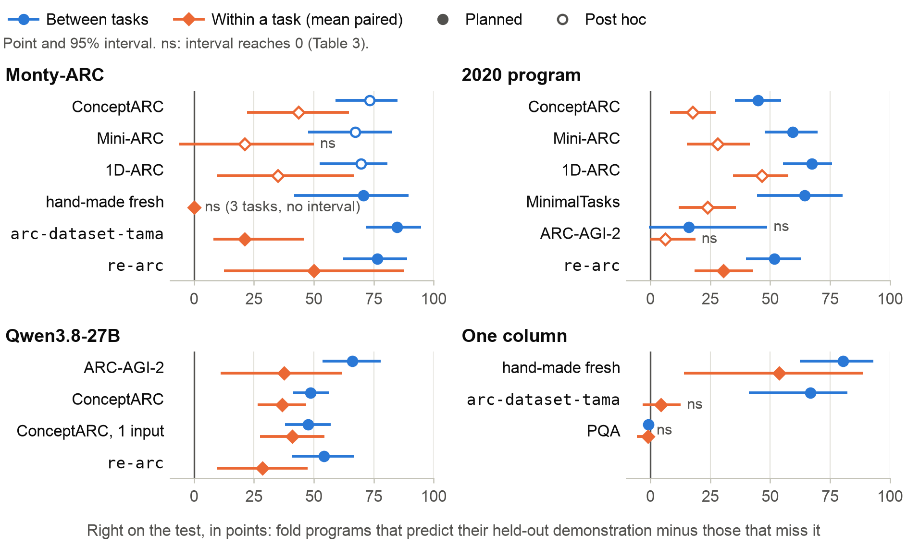
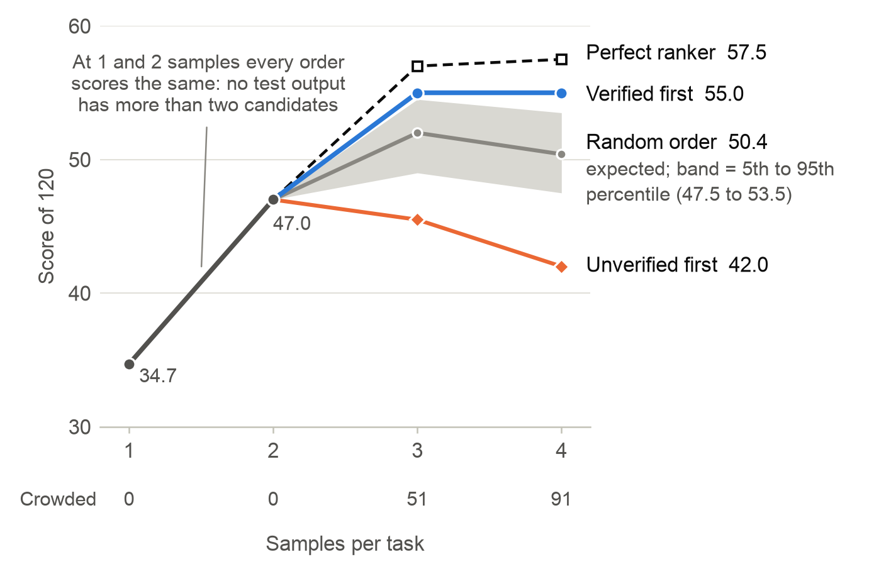

# Verified Is Not Generalised: Held-Out Re-Induction, a Distribution-Free Bound, and Where ARC Solvers Fail

*Re-running a solver with each demonstration held out separates generalising programs from proxies, gives a bound when folds agree, and tests that bound's premise with the same runs.*

## The finding

A program that fits every demonstration can still be a proxy: about a quarter of an LLM's verified ARC-AGI-2 programs fail the test. We re-run the whole solver with each demonstration held out, and answer only if every fold predicts its held-out demonstration and all folds agree on the test (FA-LOO). On four unrelated learners this separates generalising programs from proxies, within a task by 18–47 points for the LLM and a program frozen in 2020. If demonstrations and test are exchangeable, the chance of answering wrongly is at most 1/(n+1) for any symmetric learner fixed in advance. Where the premises hold by construction, on fresh generated tasks, the bound bites: the LLM's rule answers 53.5% of tasks, 107 of 107 right. On human-designed sets the same runs reject the premises for the LLM, so there the rule is evidence, not a guarantee. Letting failed folds retry gives 16 of 16 at 13.3% coverage on ARC-AGI-2 (planned replication, seen split). The rule raises no score: at four samples verification scores 55.0 of 120 and a perfect ranker 57.5, so proposal, not selection, is the bottleneck.

The question came from the Thousand Brains Theory; Monty-ARC, the solver we built on it, is one of the four learners and scores 0.00 alone.

## The submission

- **Submission ID 57726521. Public score 32.64. Track: ARC-AGI-2.**
- Public notebook, version 3: https://www.kaggle.com/code/rahim3/monty-arc-qwen-nvarc?scriptVersionId=362731624 (Kaggle's latest is v4-A, 27.36).
- Final field: 3,544 teams, top 88.06, median 29.31. Rank 220; 59 teams tie at 32.64.

**What it is.** An NVARC fork [2] with a Qwen3.8-27B program-synthesis front end and Monty-ARC (CPU) merged in, run offline on 4×L4 GPUs for 12 hours. Qwen samples one program per task for up to 4.5 h; a program is *verified* if it reproduces every demonstration. The NVARC fork then runs to the deadline, skipping tasks with a verified program. Per test output the merge takes: verified Qwen output; a confident Monty-ARC answer; NVARC's candidates; then unverified Qwen output, a verified program's second grid and Monty-ARC guesses. The first two distinct grids are submitted.

**What it is not.** FA-LOO is not in it; the rule was evaluated offline.

**What the score means.** Two unchanged runs scored 32.64 and 29.72, both inside the 28–34 band that forum reports give for unmodified NVARC forks, so we cannot credit Qwen with the difference. Without NVARC, on the 120 public evaluation tasks (seen), one 16k sample per task, the parts give:

| Parts, score of 120 | Run 1 | Run 2 |
|---|---|---|
| Qwen3.8-27B alone | 21.0 | 18.0 |
| With Monty-ARC merged | 24.0 | 21.0 |

Monty-ARC alone scored 0.00 twice on the hidden set; its contribution is likely near zero.

## The rule and the theorem

> **FA-LOO.** Re-run the whole solver with each demonstration held out in turn. Answer ŷ only if (a) every fold predicts its held-out demonstration, (b) every fold predicts ŷ on the test, and, optionally, (c) the run on all n demonstrations also outputs ŷ.

**Theorem.** If the learner is symmetric in its inputs (S) and fixed in advance (F), and the n demonstrations and the test pair are exchangeable (E), then P(answer and wrong) ≤ 1/(n+1).

The proof adapts the leave-two-out tournament of the jackknife+ [3]: at most one of a task's n+1 pairs, playing test, can produce a confident error, and under the premises each is equally likely to. The bound is joint and a worst case: at coverage c it gives precision at least 1 − 1/((n+1)c).

CORA [1] came first with re-induction on each held-out demonstration, and reports certified programs right 40 of 42 times against 37 of 201 for uncertified train-perfect ones. We extend the split to four unrelated learners with within-task controls, and add agreement, which gives the bound.

## The evidence

Learners: Monty-ARC, Qwen3.8-27B writing programs, the 2020 Kaggle winner's search, and a one-column system.

*Figure 1 (paper Figure 2). Right on the test, predicting minus missing fold programs, in points, 95% intervals; circles between tasks, diamonds within.*

**The held-out split.** Between tasks the gap is 45–85 points on every row but two (the 2020 program on ARC-AGI-2, the one-column system on PQA). Easy tasks produce both predicting programs and right answers, so within a task is the stricter test: 18–47 points for Qwen and the 2020 program, and separates everywhere except the 2020 program on ARC-AGI-2.

**Against the usual test.** FA-LOO is more precise than fit (any program that fits every demonstration) on every row of paper Table 4, separably on all but three: 73–100% against 30–94%, at coverage of 3–54%. On Qwen's ARC-AGI-2, ConceptARC and `re-arc` rows it answers 179 tasks with none wrong and rejects all 48 verified-but-wrong tasks, at the price of 139 of 318 fully right ones. In the one-input ConceptARC run it answers 80 tasks, one wrongly.

**Where the bound bites.** On 200 fresh `re-arc` [4] tasks, three demonstrations and a test drawn i.i.d. from one generator (bound 0.25), the premises hold by construction. Qwen's rule answers 107 of 200, all right, at coverage 53.5% [46.5, 60.5]; the bound's floor on precision is 53.3%. The concepts are ARC-AGI-1's; new ones are untested.

**The retry rule.** On ARC-AGI-2, 22 of 31 failing folds on rejected right tasks are search failures.

> **Retry rule.** A fold that does not fit its own n−1 demonstrations gets another sample, at most twice.

It is part of the learner, so the theorem still applies. Post hoc it took 7/7 to 15/15; a planned replication with fresh runs gave 16 of 16 at 13.3% coverage, for about 2.4× the tokens of one pass. On a seen split this shows usefulness, not the bound.

**A test of exchangeability.** Under the premises a fold is as likely right on its held-out demonstration as on the test. On `re-arc` no learner separates. Qwen's held-out minus test is +5.0 [+1.5, +8.6] on ARC-AGI-2 and −5.1 [−8.1, −2.1] on ConceptARC, still −8.2 [−11.9, −4.5] with one test input per prompt, so sibling inputs are not the cause. Judged: on ConceptARC this is one learner's joint rejection of (E) and (F), not an established property of the benchmark.

**The ranking ceiling.** At four samples verified-first scores 55.0 of 120, a perfect ranker 57.5 and unverified-first 42.0. At one sample per task, the notebook's setting, every merge order scores 22–24.

*Figure 2 (paper Figure 3). Score of 120 on ARC-AGI-2 public evaluation by candidate order; Qwen at 32k, logged runs, seen split.*

## Where ARC solvers fail

- **Demonstrations under-determine the rule.** On ConceptARC, 62 of 68 failing folds on rejected right tasks fit their own demonstrations and miss the held-out one.
- **Proxies fit every fold** (judged). Of Monty-ARC's ten wrong confident ConceptARC pairs, 5 are tests outside the demonstrations' range and 4 are proxies. Qwen's one wrong answer, AboveBelow9 (keep what lies above a divider), keeps the side whose shape touches the divider with fewer cells: above in both demonstrations, below in the test.
- **Proposal is the bottleneck.** Of 75 single-test ARC-AGI-2 tasks, 39 are solved by none of four samples, against 17 if samples were independent at one rate.

## What other teams can use

1. **Retry rule and certificate:** where the full pass verifies, run the folds, with retries (16 of 16 at 13.3%).
2. **Verified-first ranking** captures nearly all a ranker can at small sample counts; with many candidates per task, as in NVARC-style pipelines, this is untested.
3. **Folds can replace repeats** at equal tokens for the certificate: no measured gain, a possible loss.
4. **An exchangeability test** from the same runs: mean held-out rate minus mean test rate, not a sign test.
5. **Nulls:** perception notes in the prompt; D8 voting under a threshold.

The rule needs only a re-runnable learner; nothing outside ARC-style tasks is tested. This work does not reach 85%. What it offers teams who might is a measured statement of where effort is not worth spending, and a test they can run on any solver.

## Links

- Paper (PDF): https://github.com/ARahim3/arc-monty/blob/main/paper/paper.pdf
- Code: https://github.com/ARahim3/arc-monty
- Notebook, version 3: https://www.kaggle.com/code/rahim3/monty-arc-qwen-nvarc?scriptVersionId=362731624
- Earlier held-out certificate: CORA [1].

[1] C. W. Ndubuisi. CORA. github.com/ChimdiWalter/Symbolic_Reasoning_LLM_ARC-AGI (self-reported, unreviewed).
[2] I. Sorokin, J.-F. Puget. NVARC solution to ARC-AGI-2 (2025). github.com/1ytic/NVARC.
[3] R. F. Barber, E. J. Candès, A. Ramdas, R. J. Tibshirani. Predictive inference with the jackknife+. arXiv:1905.02928, 2019.
[4] M. Hodel. re-arc. github.com/michaelhodel/re-arc.

Abdur Rahim. Code, analysis and text were developed with Claude Code (Anthropic) under the author's direction.
